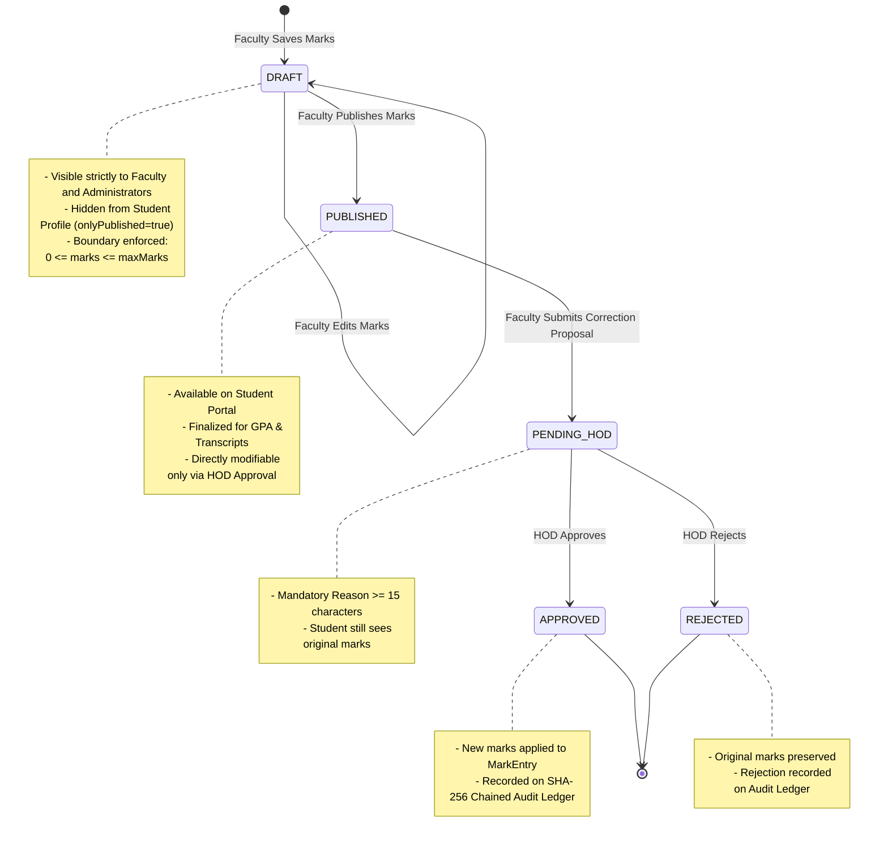
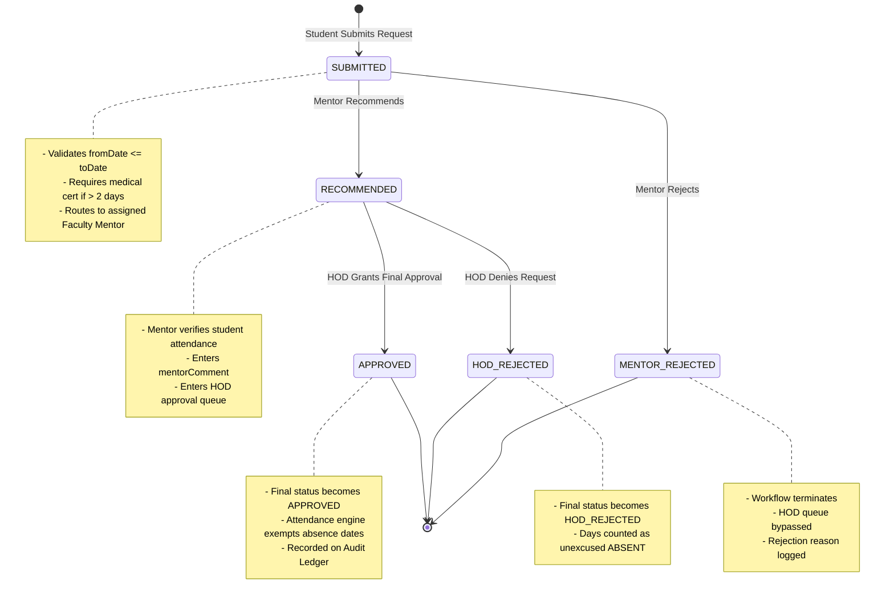

# Academic Grading & Multi-Tier Leave Workflow Guide

**Module**: Academic Grading & Multi-Tier Leave Workflow  
**Lead Engineer**: Siddhi Kolage (`@siddhi1111111` | `member-2`)  
**Standard**: IC-SRS-1.0 Section 8.3 & 8.4 | Test Cases TC-05, TC-06, TC-07  

---

## 1. Architectural Overview

The **Academic Grading & Multi-Tier Leave Workflow Module** governs two fundamental educational operations:
1. **Academic Marks Lifecycle & Governance**: Ensures fair grading through draft-vs-published isolation, strict numerical boundary enforcement ($0 \le \text{marks} \le \text{maxMarks}$), and an auditable HOD grade correction approval mechanism linked to an immutable cryptographic ledger.
2. **Multi-Stage Leave Approval Hierarchy**: Enforces campus absence policies, mandatory medical certification rules for extended absences ($> 2$ days), advance notice constraints, and a dual-approver state machine (`Student` $\rightarrow$ `Faculty Mentor` $\rightarrow$ `Department HOD`).

---

## 2. Academic Marks Lifecycle & Correction Governance

### 2.1. Draft vs. Published Marks Lifecycle
Faculty members grade coursework (In-Semester Exams, Mid-Terms, Practicals, and Finals) with atomic transition controls:



#### Policy & Validation Rules (IC-SRS-1.0 Section 8.3 & TC-05):
- **Boundary Validation**: Marks entered must satisfy $0.0 \le \text{marks} \le \text{maxMarks}$.
- **Privacy Isolation**: Endpoint `/api/academics/marks/student/{studentId}?onlyPublished=true` excludes `DRAFT` records.
- **Correction Justification**: Any proposal to alter published marks requires a justification of **at least 15 characters**.
- **Cryptographic Audit**: HOD approval or rejection writes an immutable block to the SHA-256 audit ledger (`MARK_CORRECTION_APPROVED` / `MARK_CORRECTION_REJECTED`).

---

## 3. Multi-Tier Leave Approval Hierarchy

### 3.1. Absence Policy Constraints
Students submitting leave requests must adhere to academic governance standards (IC-SRS-1.0 Section 8.4 & TC-07):
1. **Date Logic**: $\text{fromDate} \le \text{toDate}$.
2. **Advance Application**: Requests must be submitted at least **24 hours prior** to leave start date (excluding emergency medical leaves).
3. **Medical Certification Rule**: For leaves exceeding **2 calendar days** ($\text{daysCount} > 2$), an uploaded medical certificate filename and URL are **mandatory**.

### 3.2. Leave State Transition Diagram



---

## 4. REST API Endpoint Reference

### 4.1. Save or Update Mark Entry
Saves an evaluation score in `DRAFT` or `PUBLISHED` status.

- **Method**: `POST`
- **Path**: `/api/academics/marks`
- **Headers**: `Content-Type: application/json`

#### Request Payload:
```json
{
  "studentId": 100,
  "subjectId": 50,
  "facultyId": 10,
  "exam": "Mid-Term Examination",
  "marks": 24.5,
  "maxMarks": 30.0,
  "status": "DRAFT"
}
```

#### Response (`200 OK`):
```json
{
  "id": 55,
  "studentId": 100,
  "studentName": "Rohan Gupta",
  "rollNo": "2024-CS-088",
  "subjectId": 50,
  "subjectCode": "CS302",
  "subjectName": "Database Management Systems",
  "exam": "Mid-Term Examination",
  "marks": 24.5,
  "maxMarks": 30.0,
  "status": "DRAFT",
  "updatedBy": "Prof. S. Patil",
  "updatedAt": "2026-10-14T09:15:00"
}
```

---

### 4.2. Submit Grade Correction Proposal
Initiates an auditable mark modification request requiring Department Head sign-off.

- **Method**: `POST`
- **Path**: `/api/academics/marks/corrections`
- **Headers**: `Content-Type: application/json`

#### Request Payload:
```json
{
  "markId": 55,
  "facultyId": 10,
  "newMarks": 27.0,
  "reason": "Re-evaluation of question 3B after answer booklet verification"
}
```

#### Response (`200 OK`):
```json
{
  "id": 201,
  "markId": 55,
  "studentName": "Rohan Gupta",
  "rollNo": "2024-CS-088",
  "subjectCode": "CS302",
  "exam": "Mid-Term Examination",
  "oldMarks": 24.5,
  "newMarks": 27.0,
  "reason": "Re-evaluation of question 3B after answer booklet verification",
  "facultyName": "Prof. S. Patil",
  "status": "PENDING_HOD",
  "requestedAt": "2026-10-14T09:20:00",
  "decisionComment": null
}
```

---

### 4.3. HOD Mark Correction Decision
HOD approves or rejects the proposed mark change.

- **Method**: `PUT`
- **Path**: `/api/academics/marks/corrections/{id}/decision`
- **Headers**: `Content-Type: application/json`

#### Request Payload:
```json
{
  "approved": true,
  "hodId": 20,
  "comment": "Approved following paper verification with department exam coordinator"
}
```

#### Response (`200 OK`):
```json
{
  "id": 201,
  "markId": 55,
  "studentName": "Rohan Gupta",
  "rollNo": "2024-CS-088",
  "subjectCode": "CS302",
  "exam": "Mid-Term Examination",
  "oldMarks": 24.5,
  "newMarks": 27.0,
  "status": "APPROVED",
  "decisionComment": "Approved following paper verification with department exam coordinator"
}
```

---

### 4.4. Student Leave Application
Submits a leave request along with policy verification.

- **Method**: `POST`
- **Path**: `/api/leave/requests`
- **Headers**: `Content-Type: application/json`

#### Request Payload:
```json
{
  "studentId": 10,
  "fromDate": "2026-10-20",
  "toDate": "2026-10-23",
  "reason": "Recovery following viral fever and hospitalization",
  "attachmentName": "medical_fitness_cert.pdf",
  "attachmentUrl": "https://storage.intellicampus.edu/med/cert_981.pdf"
}
```

#### Response (`200 OK`):
```json
{
  "id": 501,
  "studentId": 10,
  "studentName": "Ananya Desai",
  "rollNo": "2024-CS-099",
  "departmentName": "Computer Science",
  "fromDate": "2026-10-20",
  "toDate": "2026-10-23",
  "daysCount": 4,
  "reason": "Recovery following viral fever and hospitalization",
  "attachmentName": "medical_fitness_cert.pdf",
  "attachmentUrl": "https://storage.intellicampus.edu/med/cert_981.pdf",
  "mentorId": 2,
  "mentorName": "Prof. R. Mehta",
  "mentorStatus": "SUBMITTED",
  "mentorComment": null,
  "hodId": null,
  "hodName": null,
  "hodStatus": "SUBMITTED",
  "hodComment": null,
  "finalStatus": "SUBMITTED",
  "submittedAt": "2026-10-14T09:25:00",
  "decidedAt": null
}
```

---

### 4.5. Mentor Review Decision
Faculty mentor reviews and recommends or rejects the student's leave.

- **Method**: `PUT`
- **Path**: `/api/leave/requests/{id}/mentor-review`
- **Headers**: `Content-Type: application/json`

#### Request Payload:
```json
{
  "approved": true,
  "approverId": 2,
  "status": "RECOMMENDED",
  "comment": "Medical certificate verified with doctor. Forwarded to HOD for approval."
}
```

---

### 4.6. HOD Final Leave Review
Department Head grants final approval or denies the request.

- **Method**: `PUT`
- **Path**: `/api/leave/requests/{id}/hod-review`
- **Headers**: `Content-Type: application/json`

#### Request Payload:
```json
{
  "approved": true,
  "approverId": 3,
  "status": "APPROVED",
  "comment": "Leave granted. Attendance credit applied for 4 missed lecture days."
}
```

---

## 5. Verification & Test Suite Reference
Automated test suites validating Academics & Leave functionality:
- **Marks Publishing & HOD Audit Tests**: [`MarksServiceTest.java`](file:///c:/Users/DELL/Desktop/link%20code/Antigravity/backend/src/test/java/com/intellicampus/academics/MarksServiceTest.java)
- **Leave Lifecycle State Tests**: [`LeaveServiceTest.java`](file:///c:/Users/DELL/Desktop/link%20code/Antigravity/backend/src/test/java/com/intellicampus/leave/LeaveServiceTest.java)
- **Frontend / JavaScript Unit Tests**: [`HodView.test.js`](file:///c:/Users/DELL/Desktop/link%20code/Antigravity/src/components/__tests__/HodView.test.js) & [`HodView.test.jsx`](file:///c:/Users/DELL/Desktop/link%20code/Antigravity/src/components/__tests__/HodView.test.jsx)
