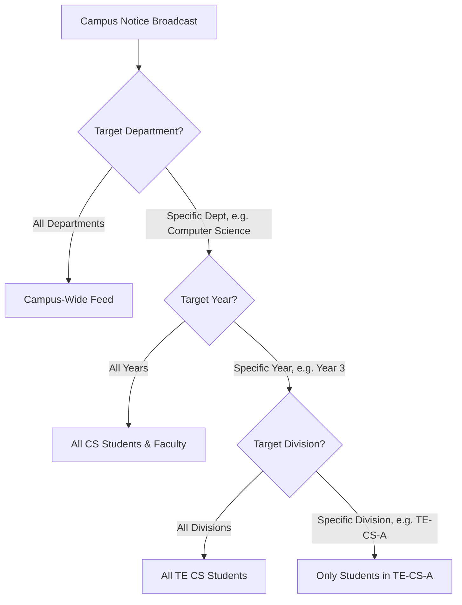

# User Directory Administration, Academic Setup & Campus Notices Manual

**Module**: User Administration, Academic Setup & Campus Notices  
**Lead Engineer**: Gayatri Jadhav (`@jgayatri664` | `member-3`)  
**Standard**: IC-SRS-1.0 Section 8.5 | Test Cases TC-09 & TC-10  

---

## 1. Architectural Overview

The **User Administration, Academic Setup & Campus Notices Module** serves as the administrative core of the IntelliCampus platform, providing:
1. **High-Throughput User Provisioning**: Automated ingestion of student, faculty, and administrative accounts through individual REST endpoints or bulk CSV ingestion with line-by-line error isolation.
2. **Classroom Geofencing Setup**: Centralized management of physical campus facilities, linking lecture halls and laboratories to precise decimal GPS coordinates ($latitude$, $longitude$) and allowable boundary radiuses.
3. **Targeted Broadcast Notice Engine**: Precision notice delivery filtering across three hierarchical audience axes (`Department` $\times$ `Academic Year` $\times$ `Division`) with automated read receipt tracking.

---

## 2. Bulk CSV Ingestion & Directory Provisioning

### 2.1. Standard CSV Header Specification
To ensure deterministic ingestion, student rosters must adhere to the mandatory schema defined in `CsvUserValidator.java`:

| Header Name | Type | Mandatory | Example | Format / Constraints |
| :--- | :--- | :---: | :--- | :--- |
| `usercode` | String | Yes | `STU-2024-001` | Unique campus ID; non-empty |
| `name` | String | Yes | `Aarav Mehta` | Full student name |
| `email` | String | Yes | `aarav@intellicampus.edu` | Valid email format (`^[^@\s]+@[^@\s]+\.[^@\s]+$`); unique |
| `department` | String | Yes | `Computer Science` | Standard college department name |
| `rollno` | String | Yes | `2024-CS-042` | Official student roll number |

### 2.2. Sample CSV Template
```csv
usercode,name,email,department,rollno
STU-001,Aarav Ramesh Mehta,aarav.mehta@intellicampus.edu,Computer Science,2024-CS-001
STU-002,Priya Suresh Sharma,priya.sharma@intellicampus.edu,Computer Science,2024-CS-002
STU-003,Rohan Santosh Kulkarni,rohan.k@intellicampus.edu,Computer Science,2024-CS-003
STU-004,Ananya Vijay Desai,ananya.desai@intellicampus.edu,Information Technology,2024-IT-001
STU-005,Vikram Ashok Shinde,vikram.shinde@intellicampus.edu,Mechanical Engineering,2024-MECH-001
```

### 2.3. Malformed Row Isolation & Error Reporting
Under the IntelliCampus fault-tolerant ingestion protocol (TC-09), a single malformed row does **not** fail the entire batch. Instead:
- Valid rows are committed into MySQL.
- Invalid rows (e.g. malformed email address, duplicate email within file or database, missing required column) are isolated into a detailed error report specifying the exact CSV line number:

```json
{
  "totalProcessed": 5,
  "importedCount": 3,
  "failedCount": 2,
  "errors": [
    "Line 3: Invalid email format 'priya.sharma-at-campus'",
    "Line 5: Duplicate email 'aarav.mehta@intellicampus.edu' detected in batch"
  ]
}
```

---

## 3. Classroom GPS Geofencing Configuration Guide

Every physical classroom or laboratory used for Smart Attendance must be configured with central coordinates and allowable perimeter bounds.

### 3.1. Extracting High-Precision Coordinates

#### Method A: Google Maps (Desktop Web)
1. Navigate to [Google Maps](https://www.google.com/maps).
2. Zoom into your campus building until individual lecture halls/wings are visible.
3. Right-click on the center of the classroom.
4. Click on the first item in the context menu to copy the latitude and longitude (e.g. `18.5204303, 73.8567437`).
5. Ensure 6 decimal places of precision (~0.1m precision).

#### Method B: OpenStreetMap
1. Open [OpenStreetMap](https://www.openstreetmap.org).
2. Right-click on the facility and select **Show address**.
3. Copy the coordinate pair displayed in the left panel.

### 3.2. Geofence Boundary Calibration

$$\text{Allowable Radius } (r_{\text{allowable}}) = \begin{cases}
  30\text{ m} & \text{Compact Computer Labs (20--40 capacity)} \\
  50\text{ m} & \text{Standard Lecture Theatres (60--100 capacity) [Default]} \\
  80\text{ m} & \text{Central Auditorium / Seminar Complex}
\end{cases}$$

> [!IMPORTANT]
> The system enforces a hard limit: device reported GPS accuracy ($A_{\text{gps}}$) must be $\le 100\text{ m}$. Coordinates from devices with accuracy $> 100\text{ m}$ are automatically rejected to prevent cell-tower spoofing.

---

## 4. Targeted Campus Notice Broadcast Engine

### 4.1. Audience Taxonomy Matrix
Campus notices are classified across three orthogonal audience dimensions:

$$\text{Notice Broadcast Scope} = \text{Department} \times \text{Academic Year} \times \text{Division}$$



### 4.2. Audience Filtering Truth Table

| Notice Title | Target Dept | Target Year | Target Div | Student A (CS, Year 3, TE-CS-A) | Student B (CS, Year 2, SE-CS-B) | Student C (Mech, Year 3, TE-ME-A) |
| :--- | :--- | :--- | :--- | :---: | :---: | :---: |
| **Annual Sports Gala** | `All Departments` | `All Years` | `All Divisions` | ✅ Visible | ✅ Visible | ✅ Visible |
| **CS Dept Hackathon** | `Computer Science` | `All Years` | `All Divisions` | ✅ Visible | ✅ Visible | ❌ Hidden |
| **TE CS Synopsis Submission** | `Computer Science` | `Year 3` | `All Divisions` | ✅ Visible | ❌ Hidden | ❌ Hidden |
| **TE-CS-A Lab Schedule** | `Computer Science` | `Year 3` | `TE-CS-A` | ✅ Visible | ❌ Hidden | ❌ Hidden |

### 4.3. Student Read Receipt Tracking
When a student opens a notice detail view, the client transmits:

$$\text{POST } /api/notices/\{noticeId\}/read?userId=\{userId\}$$

- **Idempotency**: The combination of `(notice_id, user_id)` is unique. Subsequent views by the same student will not duplicate read receipts.
- **Analytics**: Administrators and publishers monitor total readership count in real time (`readsCount`).

---

## 5. REST API Reference

### 5.1. User Administration Endpoints

#### Create User
- **Method**: `POST`
- **Path**: `/api/users`
- **Headers**: `Content-Type: application/json`

```json
{
  "userCode": "STU-2024-001",
  "name": "Aarav Ramesh Mehta",
  "email": "aarav.mehta@intellicampus.edu",
  "role": "STUDENT",
  "department": "Computer Science",
  "rollNo": "2024-CS-001",
  "division": "TE-CS-A"
}
```

#### Bulk Import CSV
- **Method**: `POST`
- **Path**: `/api/users/import-csv`
- **Headers**: `Content-Type: application/json`

```json
[
  "usercode,name,email,department,rollno",
  "STU-001,Aarav Mehta,aarav@intellicampus.edu,Computer Science,2024-CS-001",
  "STU-002,Priya Sharma,priya@intellicampus.edu,Computer Science,2024-CS-002"
]
```

---

### 5.2. Notice Broadcast Endpoints

#### Publish Notice
- **Method**: `POST`
- **Path**: `/api/notices`
- **Headers**: `Content-Type: application/json`

```json
{
  "title": "TE Computer Science Mini Project Synopsis Deadline",
  "body": "All third-year Computer Science students must upload their project synopsis before Friday 5:00 PM.",
  "targetDepartment": "Computer Science",
  "targetYear": "Year 3",
  "targetDivision": "All Divisions",
  "publisherRole": "HOD Office",
  "publisherId": 20,
  "deadline": "2026-10-24T17:00:00",
  "hasAttachment": true,
  "fileName": "synopsis_rubric_2026.pdf",
  "attachmentUrl": "https://storage.intellicampus.edu/notices/synopsis_rubric.pdf"
}
```

#### Fetch Student Personalized Feed
- **Method**: `GET`
- **Path**: `/api/notices/feed?userId={userId}`
- **Response (`200 OK`)**: List of notices matching student's department, year, division, plus campus broadcasts.

#### Record Notice Read Receipt
- **Method**: `POST`
- **Path**: `/api/notices/{id}/read?userId={userId}`
- **Response (`200 OK`)**: `true` on first view, `false` if already recorded.

---

## 6. Verification & Test Suite Reference
Automated test suites guaranteeing compliance:
- **User CRUD & CSV Ingestion Tests**: [`UserServiceTest.java`](file:///c:/Users/DELL/Desktop/link%20code/Antigravity/backend/src/test/java/com/intellicampus/user/UserServiceTest.java)
- **Notice Audience Filtering Tests**: [`NoticeServiceTest.java`](file:///c:/Users/DELL/Desktop/link%20code/Antigravity/backend/src/test/java/com/intellicampus/notice/NoticeServiceTest.java)
- **Frontend / JavaScript Unit Tests**: [`AdminView.test.js`](file:///c:/Users/DELL/Desktop/link%20code/Antigravity/src/components/__tests__/AdminView.test.js) & [`AdminView.test.jsx`](file:///c:/Users/DELL/Desktop/link%20code/Antigravity/src/components/__tests__/AdminView.test.jsx)
