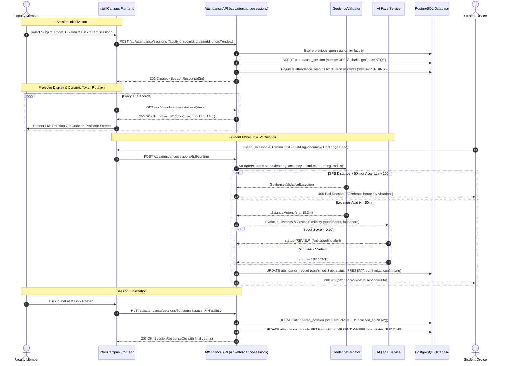

# Smart Attendance & Multimodal Verification Specification

**Module**: Smart Attendance & Multimodal Verification  
**Lead Engineer**: Bhumika Khairnar (`@khairnarbhumika34-ship-it` | `member-1`)  
**Standard**: IC-SRS-1.0 Section 8.2 & 8.6 | Test Cases TC-02, TC-03, TC-04  

---

## 1. Architectural Overview

The **Smart Attendance & Multimodal Verification System** prevents proxy attendance, location spoofing, and QR replay attacks in college classrooms by combining:
1. **Dynamic Time-Slotted QR Tokens** rotated cryptographically every 15 seconds.
2. **Geofenced Haversine Boundary Validation** enforcing physical student presence within a configurable classroom radius (default 50 meters).
3. **Multi-Modal AI Anti-Spoofing & Facial Verification** evaluating biometric liveness and face matching before confirming attendance.
4. **Automated Session Finalization** transitioning unconfirmed students to `ABSENT` upon session expiration with complete faculty manual override capability.

---

## 2. Mathematical & Cryptographic Foundations

### 2.1. Haversine Great Circle Distance Formula
To verify whether a student device is physically inside the designated classroom, the backend and frontend implement the Haversine formula on spherical coordinates:

$$\Delta\phi = \phi_2 - \phi_1 = \text{radians}(\text{lat}_2 - \text{lat}_1)$$

$$\Delta\lambda = \lambda_2 - \lambda_1 = \text{radians}(\text{lon}_2 - \text{lon}_1)$$

$$a = \sin^2\left(\frac{\Delta\phi}{2}\right) + \cos(\phi_1) \cdot \cos(\phi_2) \cdot \sin^2\left(\frac{\Delta\lambda}{2}\right)$$

$$c = 2 \cdot \text{atan2}\left(\sqrt{a}, \sqrt{1 - a}\right)$$

$$d = R \cdot c$$

Where:
- $R = 6,371,000 \text{ m}$ (mean Earth radius in meters)
- $\phi_1, \lambda_1$: Central classroom latitude and longitude
- $\phi_2, \lambda_2$: Student device reported GPS coordinates
- $d$: Great circle distance in meters

#### Policy Constraints:
1. **Perimeter Boundary**: Check-in is valid if and only if $d \le r_{\text{allowable}}$ (where $r_{\text{allowable}}$ is default 50 meters).
2. **Device GPS Accuracy Guardrail**: If device reported accuracy threshold $A_{\text{gps}} > 100 \text{ m}$, the check-in is unconditionally rejected to prevent cell-tower or Wi-Fi geo-spoofing.

---

### 2.2. Dynamic 15-Second Rotating QR Protocol
To prevent students from capturing a screenshot of the QR code and sharing it with absent peers, QR tokens rotate synchronously every 15 seconds:

$$\text{slot} = \left\lfloor \frac{t_{\text{epoch}}}{15000} \right\rfloor$$

$$\text{secondsLeft} = 15 - \left(\left\lfloor \frac{t_{\text{epoch}}}{1000} \right\rfloor \bmod 15\right)$$

$$\text{payload} = \text{"secret\_key:"} + \text{sessionId} + \text{":"} + \text{slot}$$

$$\text{token} = \text{"IC-"} + \text{SHA256}(\text{payload})[0..16].\text{toUpperCase()}$$

#### Protocol Characteristics:
- **Token Format**: `IC-` prefix followed by 16 uppercase hexadecimal characters (e.g. `IC-B8D24E01F9A7C532`).
- **Validity Window**: Tokens are strictly bounded to the current 15-second time slot.
- **Replay Protection**: Expired tokens cannot be submitted for attendance confirmation.

---

## 3. End-to-End Workflow Sequence Diagram

The following Mermaid sequence diagram illustrates the lifecycle from faculty session initialization to student check-in, geofence validation, AI biometric evaluation, and session finalization:



---

## 4. REST API Endpoint Reference

Base Path: `/api/attendance/sessions`

### 4.1. Start Attendance Session
Creates a new live attendance session, auto-closes any previous open sessions for the faculty, and initializes the division roster as `PENDING`.

- **Method**: `POST`
- **Path**: `/api/attendance/sessions`
- **Headers**: `Content-Type: application/json`

#### Request Body Schema:
```json
{
  "facultyId": 1,
  "subjectId": 5,
  "divisionId": 3,
  "roomId": 7,
  "challengeCode": "K7Q2",
  "photoWindowMinutes": 10
}
```

| Field | Type | Required | Description |
| :--- | :--- | :---: | :--- |
| `facultyId` | Long | Yes | User ID of the session instructor |
| `subjectId` | Long | Yes | ID of the course subject being taught |
| `divisionId` | Long | Yes | Academic division (e.g., TE-CS-A) |
| `roomId` | Long | Yes | Central classroom where geofence applies |
| `challengeCode` | String | No | 4-character code (auto-generated if omitted) |
| `photoWindowMinutes` | Integer | No | Camera window timeout (default 10) |

#### Response (`201 Created`):
```json
{
  "id": 100,
  "facultyId": 1,
  "facultyName": "Dr. Ramesh Joshi",
  "subjectId": 5,
  "subjectCode": "CS301",
  "subjectName": "Distributed Systems",
  "roomId": 7,
  "roomName": "Lab 301",
  "divisionId": 3,
  "divisionName": "TE-CS-A",
  "challengeCode": "K7Q2",
  "status": "OPEN",
  "startedAt": "2026-10-14T09:00:00",
  "photoWindowEndsAt": "2026-10-14T09:10:00",
  "finalisedAt": null,
  "totalPresent": 0,
  "totalMatched": 0,
  "totalReview": 0,
  "totalAbsent": 0,
  "records": []
}
```

---

### 4.2. Get Session Details
Retrieves live attendance metrics, challenge code, and student check-in records for a session.

- **Method**: `GET`
- **Path**: `/api/attendance/sessions/{id}`
- **Response (`200 OK`)**: `SessionResponseDto`

---

### 4.3. Get Dynamic Rotating QR Token
Generates the active 15-second rotating QR token for display on classroom projectors.

- **Method**: `GET`
- **Path**: `/api/attendance/sessions/{id}/token`
- **Response (`200 OK`)**:
```json
{
  "slot": 119463200,
  "token": "IC-A7B8C9D0E1F23456",
  "secondsLeft": 14
}
```

---

### 4.4. Student Confirm Attendance (GPS & QR Check-In)
Validates challenge code, GPS coordinates against room radius, and AI anti-spoofing scores.

- **Method**: `POST`
- **Path**: `/api/attendance/sessions/{id}/confirm`
- **Headers**: `Content-Type: application/json`

#### Request Body Schema:
```json
{
  "studentId": 10,
  "challengeCode": "K7Q2",
  "latitude": 18.52044,
  "longitude": 73.85675,
  "accuracyM": 12.0
}
```

#### Response (`200 OK`):
```json
{
  "id": 501,
  "studentId": 10,
  "studentName": "Aarav Mehta",
  "rollNo": "2024-CS-042",
  "faceScore": 0.92,
  "spoofScore": 0.95,
  "confirmed": true,
  "confirmedAt": "2026-10-14T09:05:22",
  "finalStatus": "PRESENT",
  "statusReason": "Verified via GPS Geofence (15m) and Dynamic QR Token."
}
```

#### Error Responses:
- `400 Bad Request`: Invalid challenge code, GPS accuracy > 100m, or distance > 50m.
- `409 Conflict / 400 Bad Request`: Session is not in `OPEN` status.

---

### 4.5. Transition Session Status
Transitions session lifecycle (e.g., closing camera window or finalising session).

- **Method**: `PUT`
- **Path**: `/api/attendance/sessions/{id}/status?status=FINALISED`
- **Query Parameters**:
  - `status`: `OPEN`, `PHOTO_WINDOW_CLOSED`, `EXPIRED`, `FINALISED`
- **Behavior**: Setting status to `FINALISED` automatically marks all unresolved `PENDING` records as `ABSENT`.
- **Response (`200 OK`)**: `SessionResponseDto`

---

### 4.6. Faculty Manual Attendance Override
Enables instructors to manually override an individual student's attendance record (e.g. from `REVIEW` to `PRESENT` or `ABSENT`).

- **Method**: `PUT`
- **Path**: `/api/attendance/sessions/{id}/records/{studentId}/override`
- **Headers**: `Content-Type: application/json`

#### Request Body Schema:
```json
{
  "status": "PRESENT",
  "reason": "Faculty physically confirmed student presence in row 2"
}
```

#### Response (`200 OK`): `AttendanceRecordResponseDto`

---

### 4.7. Get Active Session for Division
Retrieves the currently open session for a student's division.

- **Method**: `GET`
- **Path**: `/api/attendance/sessions/active?divisionId={divisionId}`
- **Response**:
  - `200 OK`: `SessionResponseDto` if an active session exists.
  - `204 No Content`: If no session is currently open for the division.

---

## 5. Verification & Test Suite Reference
Automated test suites guaranteeing compliance:
- **Backend Unit Tests**: [`AttendanceServiceTest.java`](file:///c:/Users/DELL/Desktop/link%20code/Antigravity/backend/src/test/java/com/intellicampus/attendance/AttendanceServiceTest.java)
- **Geofence Boundary Tests**: [`GeofenceValidatorTest.java`](file:///c:/Users/DELL/Desktop/link%20code/Antigravity/backend/src/test/java/com/intellicampus/attendance/GeofenceValidatorTest.java)
- **Spring MockMvc Tests**: [`AttendanceControllerTest.java`](file:///c:/Users/DELL/Desktop/link%20code/Antigravity/backend/src/test/java/com/intellicampus/attendance/AttendanceControllerTest.java)
- **Frontend / JavaScript Tests**: [`FacultyView.test.js`](file:///c:/Users/DELL/Desktop/link%20code/Antigravity/src/components/__tests__/FacultyView.test.js)
