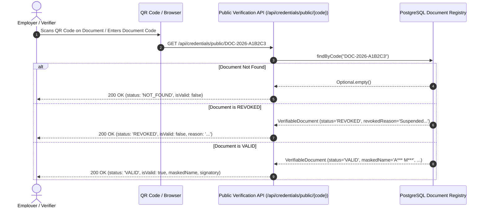

# Cryptographic Audit Ledger, Verifiable Credentials & AI Risk Analytics Specification

**Module**: Verifiable Credentials, Cryptographic Audit Ledger & AI Risk/RAG  
**Lead Engineer**: Vaishnavi Bodakhe (`@vaishnavibodakhe` | `member-4`)  
**Standard**: IC-SRS-1.0 Section 8.7 & 8.8 | Test Cases TC-08, TC-11, TC-12  

---

## 1. Architectural Overview

The **Security, Trust & AI Analytics Layer** provides enterprise-grade cryptographic guarantees and proactive student retention analytics:
1. **Tamper-Evident SHA-256 Audit Ledger**: An immutable chronological chain of system events ensuring verifiable non-repudiation across academic grade changes, attendance overrides, credential issuances, and user status modifications.
2. **Privacy-Preserving Verifiable Digital Credentials**: Instant public verification of academic credentials (degrees, marksheets, bonafide certificates) via signed QR codes with automated student identity masking.
3. **AI Early Warning System (EWS)**: A multi-factor risk assessment pipeline that evaluates attendance trends, internal grading trajectory, and academic backlogs to identify at-risk students with explainable natural language factors.

---

## 2. Cryptographic SHA-256 Audit Ledger Specification

### 2.1. Mathematical Hash Chain Formulation
Every critical system transaction generates an audit ledger entry $B_i$. The block's cryptographic identifier $\text{entryHash}_i$ is computed over canonical concatenated fields:

$$\text{entryHash}_i = \text{SHA-256}\left(\text{prevHash}_i \mid \text{actorId} \mid \text{action} \mid \text{entityType} \mid \text{entityId} \mid \text{oldValue} \mid \text{newValue} \mid \text{reason} \mid \text{createdAt}\right)$$

```mermaid
graph LR
    subgraph Block 0 Genesis
        P0[prevHash: 0000...0000] --> H0[entryHash_0 = SHA256(Payload_0)]
    end
    subgraph Block 1
        P1[prevHash: entryHash_0] --> H1[entryHash_1 = SHA256(Payload_1)]
    end
    subgraph Block 2
        P2[prevHash: entryHash_1] --> H2[entryHash_2 = SHA256(Payload_2)]
    end
    H0 --> P1
    H1 --> P2
```

#### Linkage Rules:
1. **Genesis Block**: For the initial entry ($i = 0$), $\text{prevHash}_0$ is strictly set to 64 zero hex characters:
   $$\text{GENESIS\_PREV\_HASH} = \text{"0000000000000000000000000000000000000000000000000000000000000000"}$$
2. **Chain Continuity**: For all subsequent entries ($i \ge 1$):
   $$\text{prevHash}_i = \text{entryHash}_{i-1}$$
3. **Immutable Timestamp**: $\text{createdAt}$ is formatted as ISO-8601 (`YYYY-MM-DDTHH:mm:ss.SSSSSS`) at generation time.

---

### 2.2. Tamper Detection Algorithm (TC-11)
The ledger integrity validator iterates chronologically through all blocks:

```mermaid
flowchart TD
    Start([Start Ledger Verification]) --> CheckEmpty{Ledger Empty?}
    CheckEmpty -->|Yes| Valid([Return Valid: 0 Blocks])
    CheckEmpty -->|No| Init[Set expectedPrevHash = GENESIS_PREV_HASH, i = 0]
    
    Init --> CheckLink{current.prevHash == expectedPrevHash?}
    CheckLink -->|No| BrokenLink([Return Broken: Tamper at Block i - Broken Link])
    CheckLink -->|Yes| CalcHash[Compute calculatedHash = SHA256(Payload_i)]
    
    CalcHash --> CheckHash{current.entryHash == calculatedHash?}
    CheckHash -->|No| TamperedPayload([Return Broken: Tamper at Block i - Payload Corrupted])
    CheckHash -->|Yes| NextBlock[Set expectedPrevHash = current.entryHash, i = i + 1]
    
    NextBlock --> MoreBlocks{i < Total Blocks?}
    MoreBlocks -->|Yes| CheckLink
    MoreBlocks -->|No| Intact([Return Valid: Full Ledger Intact])
```

#### Tamper Sensitivity:
- Altering **even a single character** in any historical block's payload (`oldValue`, `newValue`, `reason`, etc.) changes the computed SHA-256 digest, immediately failing condition `current.entryHash == calculatedHash`.
- Tampering with historical block sequence fails condition `current.prevHash == expectedPrevHash`.
- In both cases, the verification engine pinpoints the **exact corrupted block index** and database record ID.

---

## 3. Verifiable Digital Credentials & Public QR Verification

### 3.1. Credential Code & Digest Generation
Official academic credentials issued through IntelliCampus receive a globally unique identifier and cryptographic file digest:
- **Credential Code Format**: `DOC-YYYY-XXXXXXXXXX` (e.g. `DOC-2026-A9C3F1B4E8`).
- **File Cryptographic Digest**:
  $$\text{fileHash} = \text{SHA-256}\left(\text{docCode} \mid \text{studentName} \mid \text{rollNo} \mid \text{type} \mid \text{issueDate}\right)$$

### 3.2. Privacy-Preserving Name Masking
To comply with student data privacy standards, public verifications obscure personally identifiable information (PII):
- Rule: For each word in the student's full name, preserve the initial letter and replace remaining characters with asterisks (up to 3 asterisks).
- Example:
  $$\text{"Aarav Ramesh Mehta"} \longrightarrow \text{"A*** R*** M***"}$$

---

### 3.3. Public Verification Flow & State Machine



### 3.4. Document Revocation Policy (TC-12)
- **Mandatory Justification**: Revoking an official document requires an administrative justification of **at least 10 characters**.
- **Audit Ledger Logging**: Every revocation event is committed to the SHA-256 audit ledger (`DOCUMENT_REVOKED`).
- **Idempotency**: Documents already revoked cannot be revoked a second time (throws `IllegalStateException`).

---

## 4. AI Early-Warning System (EWS) Analytics

### 4.1. Multi-Factor Risk Heuristic Model (TC-08)
The Early Warning System evaluates academic degradation risk through an explainable scoring function:

$$\text{attPenalty} = \max\left(0, \frac{75.0 - \text{attendanceRate}}{75.0}\right) \times 0.40$$

$$\text{dropPenalty} = \max\left(0, \frac{-\text{attendanceDelta4w}}{50.0}\right) \times 0.25$$

$$\text{marksPenalty} = \max\left(0, \frac{50.0 - \text{internalMarksRate}}{50.0}\right) \times 0.20$$

$$\text{backlogPenalty} = \min\left(0.30, \text{backlogs} \times 0.10\right)$$

$$\text{rawScore} = \text{attPenalty} + \text{dropPenalty} + \text{marksPenalty} + \text{backlogPenalty}$$

$$\text{riskScore} = \text{clamp}\left(\text{round}(\text{rawScore}, 2), 0.05, 0.99\right)$$

### 4.2. Risk Classification Tiers

| Tier | Risk Score Range | Color Indicator | Recommended Intervention |
| :--- | :---: | :---: | :--- |
| **LOW** | $0.05 \le \text{riskScore} \le 0.33$ | 🟢 Green | Standard academic progression; no intervention required |
| **MEDIUM** | $0.33 < \text{riskScore} \le 0.66$ | 🟡 Amber | Faculty mentor check-in; academic advising alert |
| **HIGH** | $0.66 < \text{riskScore} \le 0.99$ | 🔴 Red | Immediate remedial counseling; parent-teacher conference |

### 4.3. Explainability Factor Extraction
To ensure full algorithmic transparency, the system extracts the top 3 contributing factors in plain English:
1. `attendanceRate < 75.0%`: `"Attendance rate below 75% threshold ({attRate}%)"`
2. `attendanceDelta4w < -10.0%`: `"Attendance dropped {abs(delta)} points in past 4 weeks"`
3. `internalMarksRate < 45.0%`: `"Internal evaluation score low ({marksRate}%)"`
4. `backlogs > 0`: `"Active backlog count: {backlogs}"`
5. `leaveDaysLast30d > 4`: `"High leave frequency: {leaveDays} days absent"`

---

## 5. REST API Endpoint Reference

### 5.1. Cryptographic Audit Ledger Endpoints

#### Verify Audit Chain Integrity
- **Method**: `GET`
- **Path**: `/api/audit/chain/verify`
- **Response (`200 OK`)**:
```json
{
  "valid": true,
  "totalBlocks": 142,
  "lastHash": "3f8a4c1e7d2b9065...f09a",
  "tamperedBlockIndex": null,
  "tamperedEntryId": null,
  "message": "Cryptographic audit hash chain is intact and uncorrupted."
}
```

#### Fetch Full Audit Ledger Chain
- **Method**: `GET`
- **Path**: `/api/audit/chain`
- **Response (`200 OK`)**: Array of `AuditLogResponseDto` entries.

---

### 5.2. Verifiable Credential Endpoints

#### Issue Verifiable Credential
- **Method**: `POST`
- **Path**: `/api/credentials`
- **Headers**: `Content-Type: application/json`

```json
{
  "type": "Bonafide Certificate",
  "studentId": 10,
  "studentName": "Aarav Ramesh Mehta",
  "rollNo": "2024-CS-042",
  "department": "Computer Science",
  "gpa": 9.12,
  "authorizedSignatory": "Office of the Registrar",
  "issuerId": 1,
  "issuerName": "Registrar"
}
```

#### Public Document Verification
- **Method**: `GET`
- **Path**: `/api/credentials/public/{code}`
- **Response (`200 OK` - Valid Document)**:
```json
{
  "code": "DOC-2026-A1B2C3D4E5",
  "type": "Bonafide Certificate",
  "maskedStudentName": "A*** R*** M***",
  "department": "Computer Science",
  "issueDate": "2026-10-14",
  "fileHash": "3a7ac6497a7e857a0477cc606f1842f819d708add7a7e1d6cf9f0869a082156b",
  "status": "VALID",
  "isValid": true,
  "signatory": "Office of the Registrar",
  "revocationReason": null
}
```

#### Revoke Document
- **Method**: `POST`
- **Path**: `/api/credentials/{code}/revoke`
- **Headers**: `Content-Type: application/json`

```json
{
  "reason": "Credential cancelled following student admission cancellation and transfer",
  "revokedById": 5,
  "revokedByName": "Dean Academics"
}
```

---

### 5.3. AI Student Risk Endpoints

#### Evaluate Student Risk
- **Method**: `POST`
- **Path**: `/api/ai/risk/evaluate/{studentId}`
- **Response (`200 OK`)**:
```json
{
  "studentId": 10,
  "riskScore": 0.84,
  "level": "HIGH",
  "topFactors": [
    "Attendance rate below 75% threshold (62.5%)",
    "Active backlog count: 2",
    "Attendance dropped 14.0 points in past 4 weeks"
  ]
}
```

---

## 6. Verification & Test Suite Reference
Automated test suites guaranteeing compliance:
- **Audit Ledger & Tamper Tests**: [`AuditChainServiceTest.java`](file:///c:/Users/DELL/Desktop/link%20code/Antigravity/backend/src/test/java/com/intellicampus/audit/AuditChainServiceTest.java)
- **Credential Verification Tests**: [`CredentialServiceTest.java`](file:///c:/Users/DELL/Desktop/link%20code/Antigravity/backend/src/test/java/com/intellicampus/credential/CredentialServiceTest.java)
- **AI Risk Assessment Tests**: [`RiskAssessmentServiceTest.java`](file:///c:/Users/DELL/Desktop/link%20code/Antigravity/backend/src/test/java/com/intellicampus/ai/RiskAssessmentServiceTest.java)
- **Frontend / JavaScript Crypto Tests**: [`cryptoAndGeo.test.js`](file:///c:/Users/DELL/Desktop/link%20code/Antigravity/src/utils/__tests__/cryptoAndGeo.test.js)
