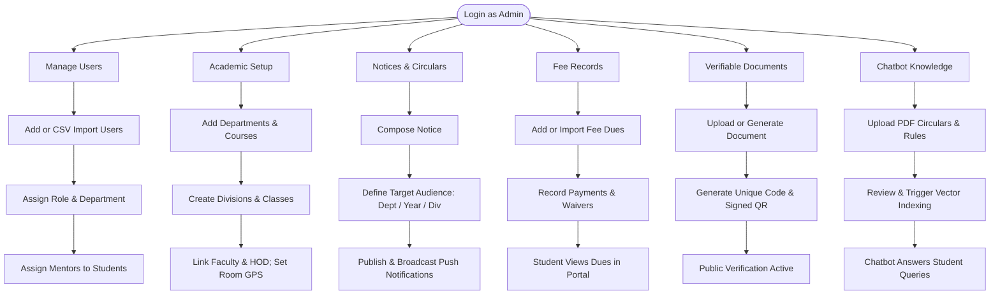
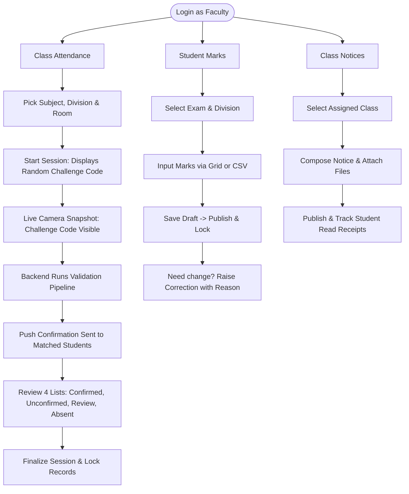
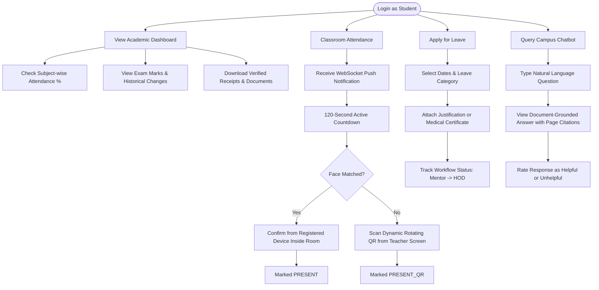
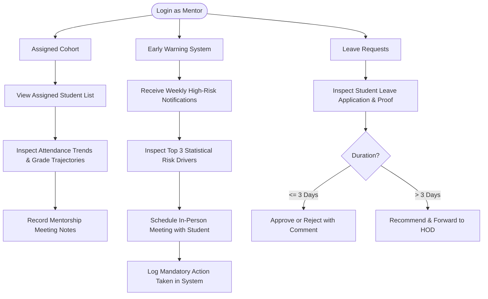
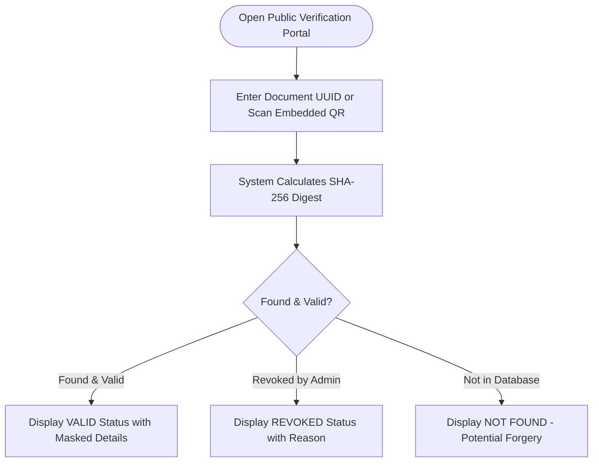

# 🔄 IntelliCampus: Role-Wise Workflows & State Machines

This document provides complete workflow flowcharts, cross-role interactions, and lifecycle state machines for all 6 user roles in **IntelliCampus**, based on the formal institutional project specifications.

---

## 👥 Role Matrix & Responsibilities

| Role | Responsibility Scope | Interacting Roles |
| :--- | :--- | :--- |
| **Admin** | Manages user lifecycles, academic structures, fee records, verifiable documents, circulars, and chatbot knowledge base. | All roles |
| **HOD** | Authorizes student leave ($>3$ days) and marks corrections; analyzes departmental attendance and academic audits. | Faculty, Mentors, Admin |
| **Faculty** | Initiates attendance sessions, captures classroom photos, enters exam marks, manages class notices, resolves disputes. | Students, HOD, Mentors |
| **Mentor** | Monitors assigned student cohort, acts on automated EWS high-risk alerts, handles first-level leave approvals. | Students, HOD, Faculty |
| **Student** | Confirms attendance within 2-min window, scans dynamic fallback QR, applies for leave, queries chatbot, views grades. | Faculty, Mentors |
| **Public Verifier** | Verifies authenticity of issued documents via public portal without login. | External parties, Employers |

---

## 🔀 Cross-Role Interconnected Workflows

```
                                      [ Leave Workflow ]
    Student applies ---> Mentor reviews & forwards ---> HOD approves/rejects ---> Student notified
                                                                                     |
                                                         (Excludes approved days from absences)

                                   [ Attendance Workflow ]
    Faculty captures photo ---> System matches faces ---> Student confirms (2 min) ---> Faculty finalizes
                                                                  |                            |
                                                      (or Fallback Dynamic QR)         (Immutable Audit)

                                  [ Mark Correction Workflow ]
    Faculty enters & publishes marks (Locked) ---> Faculty requests correction ---> HOD approves/rejects
                                                                                           |
                                                                                (Hash-Chained Audit Log)

                                     [ Document Workflow ]
    Admin issues PDF with QR & Code ---> Public Verifier checks on portal ---> Status (Valid/Revoked)

                                    [ Risk Alert Workflow ]
    System runs weekly ML model ---> Flags high-risk student ---> Mentor alerted with factors ---> Mentor logs action
```

---

## 📊 Detailed Role-Wise Workflows

### 1. Admin Workflow

The Admin sets up foundational institutional data that all other operational roles depend upon:



---

### 2. Faculty Workflow

Faculty members conduct lectures, capture attendance, record internal grades, and handle classroom exceptions:



---

### 3. Student Workflow

Students interact with their individual academic records via desktop and mobile web browsers:



---

### 4. Mentor Workflow

Mentors supervise student wellbeing, evaluate leave applications, and act on predictive early-warning alerts:



---

### 5. Head of Department (HOD) Workflow

HODs govern departmental operations, authorize sensitive grade modifications, and approve extended leaves:

```mermaid
flowchart TD
    Login([Login as HOD])
    Login --> Leave[Extended Leave Requests]
    Login --> Corrections[Mark Correction Requests]
    Login --> Reports[Department Analytics]

    Leave --> L1[Review Requests Forwarded by Mentors]
    L1 --> L2[Inspect Dates, Academic Standing & Reasons]
    L2 --> L3[Final Approve or Reject with Justification]
    L3 --> L4[Attendance Denominator Updated Automatically]

    Corrections --> C1[Receive Faculty Correction Request]
    C1 --> C2[Compare Old Grade vs New Requested Grade]
    C2 --> C3[Inspect Mandatory Faculty Reason]
    C3 --> C4[Approve or Reject]
    C4 --> C5[Approval Automatically Logged in Hash Chain]

    Reports --> R1[Defaulter Lists (< 75% Attendance)]
    Reports --> R2[Department Examination Grade Distributions]
    Reports --> R3[Export Standardized Reports (PDF / CSV)]
```

---

### 6. Public Verifier Workflow

Public third parties verify academic credentials without authentication credentials:



---

## 🔄 State Machine Specifications

### 1. Attendance Record Lifecycle

```text
                  +-----------------------------------+
                  |              PENDING              |
                  +-----------------+-----------------+
                                    |
                    +---------------+---------------+
                    |                               |
                    v                               v
           +-----------------+             +-----------------+
           |     MATCHED     |             |    UNMATCHED    |
           +--------+--------+             +--------+--------+
                    |                               |
       +------------+------------+           +------+------+
       |                         |           |             |
       v                         v           v             v
+-------------+          +---------------+ +--------+  +--------+
|   PRESENT   |          | NOT_CONFIRMED | | REVIEW |  | ABSENT |
+-------------+          +-------+-------+ +--------+  +--------+
                                 |             ^
                                 v             |
                           +------------+      |
                           | PRESENT_QR +------+ (Flagged if dual device)
                           +------------+
```

### 2. Leave Request State Machine

```text
       [ Student Submits ]
                |
                v
          +-----------+
          | SUBMITTED | -----(Student cancels)-----> [ CANCELLED ]
          +-----+-----+
                |
       (Mentor evaluates)
         /             \
        v               v
  [ REJECTED ]   +-----------------+
                 | MENTOR_APPROVED |
                 +--------+--------+
                          |
                  (HOD evaluates)
                    /          \
                   v            v
             [ REJECTED ]  [ APPROVED ]
                                |
                   (Attendance Adjusted)
```

### 3. Academic Document State Machine

```text
       [ Admin Issues Document ]
                   |
                   v
              +----------+
              |  ISSUED  | <---- (Verifiable by Public QR)
              +----+-----+
                   |
             (Admin revokes)
                   |
                   v
              +----------+
              | REVOKED  | <---- (Displays Revocation Reason)
              +----------+
```
